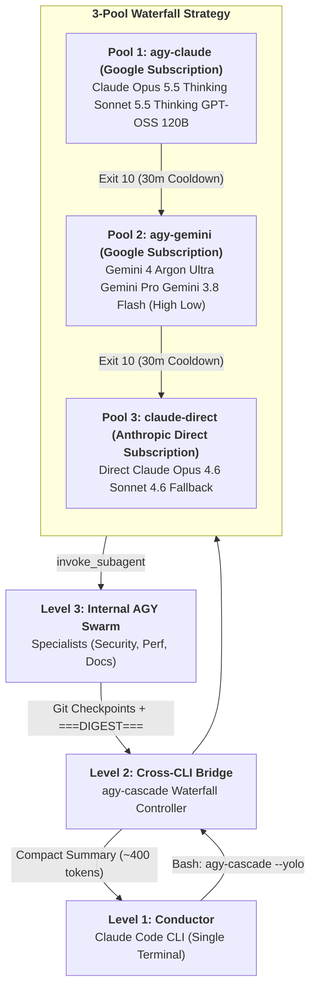

# DualAgent Nexus — Real-Time 3-Pool Waterfall & Subagent Mission Control for Claude Code + Google Antigravity

[](./LICENSE)
[-brightgreen?style=flat-square)](./server/__tests__/)
[](./contrib/agy-cascade/)
[](https://anthropic.com)
[](./contrib/agy-cascade/)
[](./client/src/utils/agentTheme.ts)
[](https://nodejs.org)

### Real-Time 3-Pool Quota Waterfall, Subagent Hierarchy Graph, Chromatic Thermal Telemetry & `===DIGEST===` Offload Tracking

Monitor and command **Claude Code** and **Google Antigravity (`agy` CLI / `~/.gemini`)** subscriptions simultaneously in a single, local-first mission control dashboard. Featuring automatic 3-pool failover on quota exhaustion (Exit Code `10`), cross-CLI delegation, and deep internal subagent swarms with context-saving digest offloading.

> [!TIP]
> **Complete guides:** [English](./README-EN.md) · [中文](./README-CN.md) · [Tiếng Việt](./README-VN.md) · [한국어](./README-KO.md) · [Español](./README-ES.md) · [agy-cascade Starter Kit](./contrib/agy-cascade/README.md)

---

## 10-Second Quick Start & Live Swarm Demo

**Prerequisites:** Node.js 22.22+ and npm 9+.

```bash
git clone https://github.com/juanmarboledao2304/dual-agent-nexus.git
cd dual-agent-nexus
npm run setup
npm run dev
```

1. Open **[http://localhost:5173](http://localhost:5173)** (or run `npm run build && npm start` for production on **[http://localhost:7770](http://localhost:7770)**).
2. Click **Run Swarm Simulation** in the top **Dual-Subscription & 3-Pool Waterfall Header**, then open **Agent Rooms** (`/rooms`) or **Cascade Hierarchy** (`/cascade-graph`).
3. Watch the **25-Second 3-Level Swarm Simulation**:
   - **0s–4s:** Level 1 Opus Conductor (`claude-opus-4-6`) and Haiku Explore scouts start on Pool 3 Claude Direct.
   - **4s–7.5s:** Level 2 `agy-cascade` bridge starts on Pool 1 (`agy-claude` / `claude-opus-5-5-thinking`); a Haiku scout repeats the same Grep four times and trips the Attention Radar loop detector.
   - **7.5s:** Pool 1 returns Exit Code `10`, starts a 30-minute cooldown, and the bridge cascades to Pool 2 (`agy-gemini` / `argon-4-ultra`).
   - **10s–17s:** the bridge fans out 3 Level 3 units on Gemini 3.8 Flash; the Conductor waits on a y/n permission prompt (12.5s–17s).
   - **15s–25s:** units commit Git checkpoints, the bridge returns a `===DIGEST===` that offloads **45,200 tokens**, and every pod moves to the Completed Digest Vault.

---

## What's New in v3

- **Agent Rooms (`/rooms`):** a spatial workstation grid with four zones — Conductor Bridge (L1), Cascade Engine Room (L2), Specialist Fan-Out Pods (L3), Completed Digest Vault. Each pod shows its 8-bit sprite, role, pool pill, model, 4-bar effort meter, a 3-line mini-terminal, context use, token burn rate, and git checkpoint count. The Attention Radar flags y/n approvals, Exit Code `10`, and tools repeated 4+ times in a row. The classic status board lives at `/rooms?layout=board`.
- **8-bit sprite engine:** every agent renders as a pure-SVG pixel character chosen by pool and tier (Opus Conductor, Sonnet Engineer, Haiku Scout, Opus 5.5 Thinking, Sonnet 5.5 / GPT-OSS, Argon 4 Ultra, Gemini Pro, Gemini 3.8 Flash), animated by state: thinking, working (tool badge), approval required, completed (`DIGEST`).
- **Quick Workflow Presets** in the Command Center Dock: `Spec + agy-cascade --yolo`, `3-Unit Fan-Out + DIGEST`, `Haiku Fast Explore`, `Git Checkpoint + Diff Audit`. A preset loads engine, model, effort, and a prompt template; dispatching stays an explicit click.
- **Navigation:** Overview Deck (`/`), Agent Rooms (`/rooms`), Cascade Hierarchy (`/cascade-graph`), Session Logs (`/sessions`), Activity Stream (`/activity`), Quota & Digest ROI (`/quota-roi`), System Configuration (`/settings`). The v2 paths `/kanban`, `/workflows`, and `/analytics` redirect and keep their query strings.
- **Default port `7770`** (fallbacks `7771`–`7779`). After upgrading, re-run `node scripts/install-hooks.js --claude --antigravity` so curl hooks written for the old port are rewritten in place.

---

## The 3-Pool Waterfall Architecture



### Quota Pools Overview
1. **Pool 1 (`agy-claude`):** Google-paid Claude Opus 5.5 (High Med) Sonnet 5.5 (High) GPT-OSS 120B.
2. **Pool 2 (`agy-gemini`):** Google-paid Gemini 4/Argon Gemini Pro Gemini 3.8 Flash (High Med Low).
3. **Pool 3 (`claude-direct`):** Anthropic direct subscription (Main Conductor + final fallback on exit code `10`).

Cooldowns are tracked reactively via `~/.cache/agy-cascade/<pool>.exhausted` with automated 30-minute expiration timers and real-time WebSocket broadcast (`cascade:status`).

---

## 3-Pool Chromatic Thermal Matrix

Every agent card, subagent node, SVG bezier edge, and quota gauge is deterministically color-encoded across the 3 pools and reasoning effort tiers:

| Pool ID | Quota Source | Tier / Effort | Thermal Accent | Hex / Tailwind | Models & Roles |
| --- | --- | --- | --- | --- | --- |
| **Pool 1: `agy-claude`** | Google Subscription | `heavy` (`high` / `max`) | **Electric Fuchsia** | `#d946ef` (`fuchsia-500`) | `claude-opus-5-5-thinking`, Deep Refactoring |
| **Pool 1: `agy-claude`** | Google Subscription | `standard` (`medium`) | **Neon Indigo** | `#6366f1` (`indigo-500`) | `claude-sonnet-5-5-thinking`, `gpt-oss-120b` |
| **Pool 2: `agy-gemini`** | Google Subscription | `heavy` (`high` / `max`) | **Electric Purple / Amber** | `#a855f7` / `#f59e0b` | `argon-4-ultra`, `gemini-3-pro`, Architecture Swarm |
| **Pool 2: `agy-gemini`** | Google Subscription | `standard` (`medium`) | **Cyber Blue** | `#3b82f6` (`blue-500`) | `gemini-3-flow`, Rapid Agentic Coding |
| **Pool 2: `agy-gemini`** | Google Subscription | `light` (`low`) | **Emerald Green / Cyan** | `#10b981` / `#06b6d4` | `gemini-3.8-flash`, Parallel Subagent Recon |
| **Pool 3: `claude-direct`** | Anthropic Direct | `heavy` (`high` / `max`) | **Crimson Red** | `#ef4444` (`red-500`) | `claude-opus-4-6`, Conductor Root |
| **Pool 3: `claude-direct`** | Anthropic Direct | `standard` (`medium`) | **Vibrant Orange** | `#f97316` (`orange-500`) | `claude-sonnet-4-6`, Direct Primary Coding |
| **Pool 3: `claude-direct`** | Anthropic Direct | `light` (`low`) | **Amber Yellow** | `#fbbf24` (`amber-400`) | `claude-haiku-4-5`, High-Speed Subagents |

---

## The `contrib/agy-cascade` Starter Kit

The repository includes a ready-to-use kit in [`contrib/agy-cascade/`](./contrib/agy-cascade/):
- **[`contrib/agy-cascade/README.md`](./contrib/agy-cascade/README.md):** Complete architectural manual for 3-pool waterfall execution.
- **[`contrib/agy-cascade/CLAUDE.snippet.md`](./contrib/agy-cascade/CLAUDE.snippet.md):** Ready-to-paste snippet for `~/.claude/CLAUDE.md` to instruct Claude Code on delegation, `===DIGEST===` requirements, and Git checkpoints.
- **[`contrib/agy-cascade/agy-cascade.example.sh`](./contrib/agy-cascade/agy-cascade.example.sh):** Executable bash reference script for automated pool checking, cooldown recovery, and task invocation.

---

## Connecting Existing Terminal Sessions (Non-Destructive)

Wire both Claude Code and Google Antigravity to the dashboard with a single command:

```bash
npm run install-hooks --all
```

- **Claude Code hooks** (`~/.claude/settings.json`) stream to `http://127.0.0.1:7770/api/hooks`.
- **Google Antigravity hooks** (`~/.gemini/config/hooks.json`) stream to `http://127.0.0.1:7770/api/events?provider=antigravity`.
- **Live Transcript Watcher** tails `~/.claude/projects/**/*.jsonl` and `~/.gemini/**/*.jsonl` in real time to capture subagent invocations, `conversationId` links, and byte throughput.

---

## Extensions and Marketplace

DualAgent Nexus ships **14 plugins**, **66 plugin skills**, **18 Claude subagents**, **34 Claude commands**, and **77 total repository skills** across Claude Code and Codex formats.

```bash
claude plugin marketplace add hoangsonww/Claude-Code-Agent-Monitor
codex plugin marketplace add hoangsonww/Claude-Code-Agent-Monitor
npx skills add hoangsonww/Claude-Code-Agent-Monitor --list
```

---

## Attribution & License

- **DualAgent Nexus Architecture & 3-Pool `agy-cascade` Waterfall System:** Designed and engineered by **Juan Manuel Arboleda Orozco** ([@juanmarboledao2304](https://github.com/juanmarboledao2304)).
- **Base Platform:** Adapted under the terms of the MIT License from `Claude-Code-Agent-Monitor` by **Son Nguyen** ([@hoangsonww](https://github.com/hoangsonww)).
- **License:** [MIT License](./LICENSE). Free for personal and commercial use.
