# DualAgent Nexus

**The command center for every AI agent you run.** Watch Claude Code and Google Antigravity work side by side, see who delegated to whom, know exactly how much Claude quota you have left, and step in only when something needs you. Local-first: everything runs on your machine.

[](./LICENSE)
[](./server/__tests__/)
[](https://docs.claude.com/en/docs/claude-code)
[](./contrib/agy-cascade/)
[](https://nodejs.org)

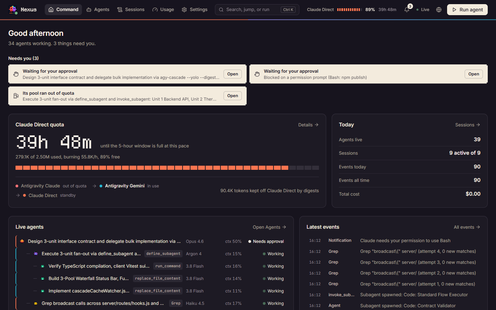

**See it in 43 seconds:** [watch the tour (MP4, with voice-over)](./docs/media/dualagent-nexus-promo.mp4)

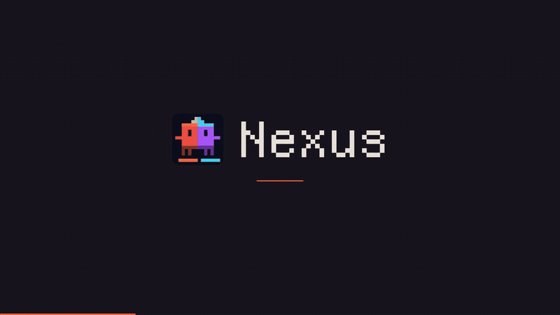

> [!TIP]
> **Full guides:** [English](./README-EN.md) · [中文](./README-CN.md) · [Tiếng Việt](./README-VN.md) · [한국어](./README-KO.md) · [Español](./README-ES.md) · [agy-cascade starter kit](./contrib/agy-cascade/README.md)

---

## Why it exists

You run a conductor in Claude Code that hands bulk work to Antigravity (`agy-cascade`), which fans out to more subagents across three quota pools. That is a lot of moving parts. Nexus answers the three questions that matter, in this order:

1. **Does anything need me?** An approval prompt, an error, an agent stuck in a loop, a pool out of quota.
2. **How much Claude Direct quota is left, and when does it run out?** The pool you pay for directly and want to protect.
3. **What are my agents doing right now?** Who is working, on what, with which model, and for how long.

Everything else (full history, costs, analytics, your Claude setup) is one click away.

## Quick start

**Prerequisites:** Node.js 22.22+ and npm 9+.

```bash
git clone https://github.com/juanmarboledao2304/dual-agent-nexus.git
cd dual-agent-nexus
npm run setup          # installs server, client, and MCP dependencies
npm run build          # builds the dashboard
npm start              # serves it on http://localhost:7770
```

Then connect your agents (one command, non-destructive, keeps your existing hooks):

```bash
npm run install-hooks --all
```

- **Claude Code** hooks go to `~/.claude/settings.json` and stream to `http://127.0.0.1:7770/api/hooks`.
- **Google Antigravity** hooks go to `~/.gemini/config/hooks.json`.
- A transcript watcher tails `~/.claude/projects/**/*.jsonl` and `~/.gemini/**/*.jsonl` to capture subagents.

Open **http://localhost:7770**. No agents running yet? Go to **Agents** and press **Simulate swarm** to play a 25-second demo of a three-level cascade (conductor, `agy-cascade` bridge, fan-out), including a pool running out of quota and an approval prompt. For development with hot reload use `npm run dev` and open http://localhost:5173.

---

## A tour of the five sections

The top bar is the same on every page: the five sections, a search field (`Ctrl K` / `Cmd K`), the **Claude Direct fuel gauge**, the **Needs you** bell, the live connection status, the language picker, and **Run agent**.

### Command


The home screen. Top to bottom:

- **Needs you.** Only the things that block work, printed as paper slips so your eye lands there first: waiting for your approval, its pool ran out of quota, stopped with an error (last 30 minutes), repeating the same tool, or quiet for 10+ minutes while marked as working. Quiet agents fold into one slip. When nothing needs you, it is a single line: *Nothing needs you right now.*
- **Claude Direct quota.** The big number is how long until your 5-hour window fills at the current pace. Under it: tokens used of the cap, burn rate, an 8-bit fuel bar, the agy-cascade waterfall (which pool is in use, which is on standby or out of quota), and how many tokens digests kept off Claude Direct.
- **Today.** Agents live, active sessions, events today and all time, total cost.
- **Live agents.** The live agent tree, one line per agent: sprite, task, current tool, model, context use, status. Finished subagents fold into *N finished*. Click any row to open the inspector with its event log.
- **Latest events.** The last tool calls as they happen; *All events* opens the full stream.

### Agents

One page, four views of the same agents. The cascade hierarchy is drawn in exactly one place.

| Tree | Timeline |
| --- | --- |
| 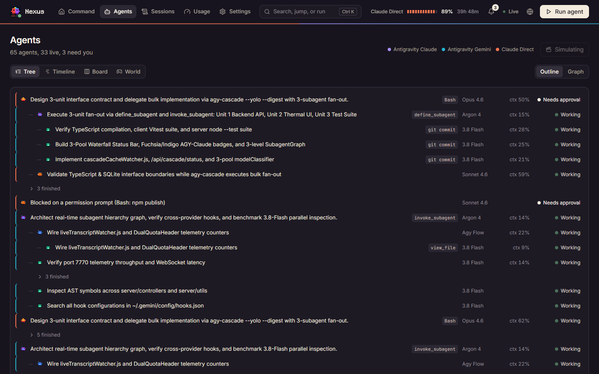 | 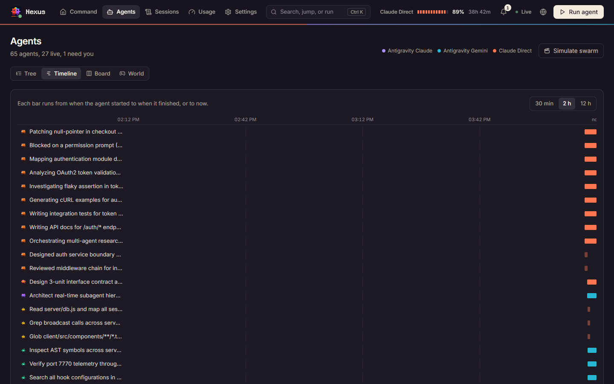 |
| **Who delegated to whom.** An indented outline; switch to **Graph** for the node-link view. | **What ran when, and for how long.** One bar per agent, coloured by pool, in a 30 min / 2 h / 12 h window. Spot concurrency and stalls. |
| **Board** | **World** |
| 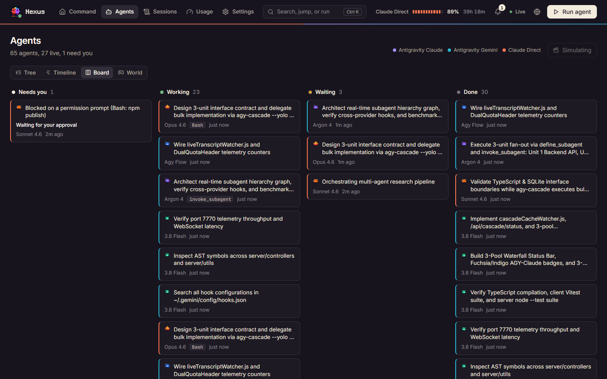 | 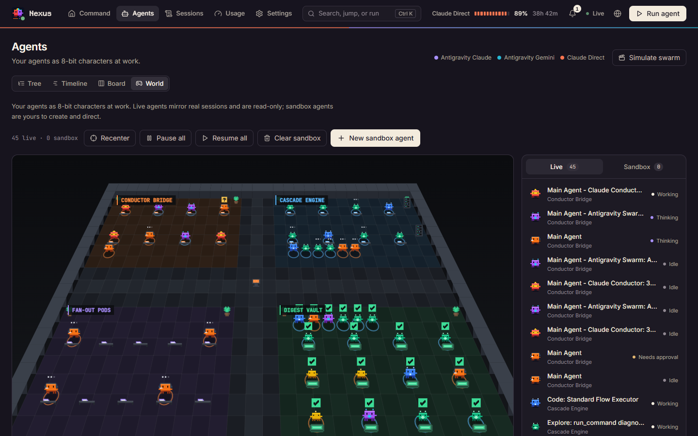 |
| **Agents by status:** Needs you, Working, Waiting, Done. Quiet agents are flagged in place. | **Your agents as 8-bit characters** in a 3/4-perspective office. Live agents are read-only; sandbox agents can be created, paused, moved, and deleted. |

Every view shares the agent inspector. **Simulate swarm** lives here too.

### Sessions

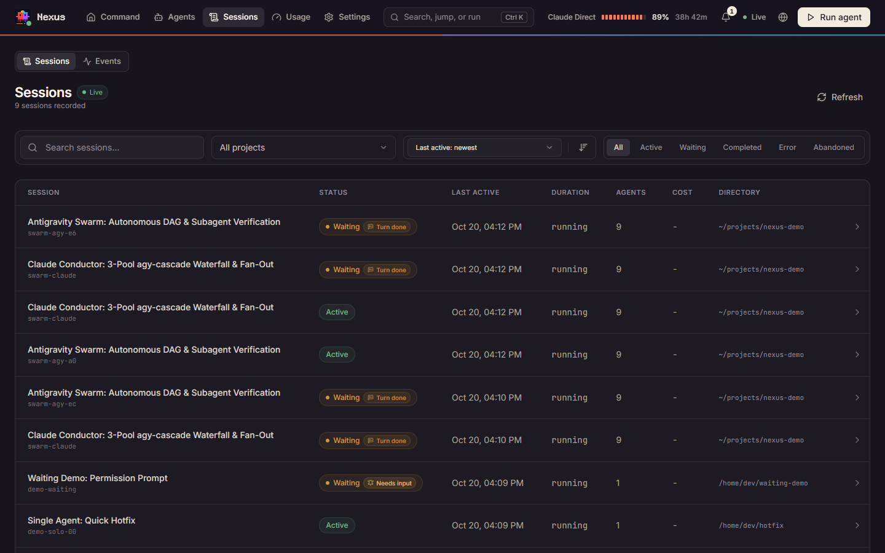

Every recorded session with status, last activity, duration, agents, and cost, plus search, project filter, and status filters. Switch to **Events** for the live event stream (pause, filter by type, tool, or session). Open a session for its agents, the full conversation, and a timeline.

### Usage

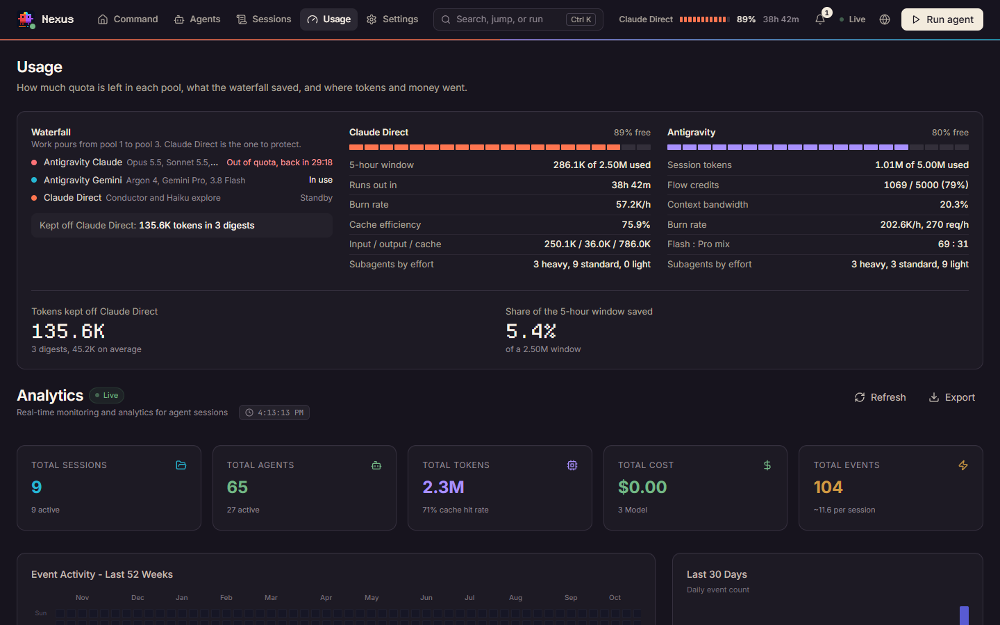

Quota first, analytics second:

- **Waterfall:** each pool's state and cooldown, and what digests saved.
- **Claude Direct:** 5-hour window, time to empty, burn rate, cache efficiency, input/output/cache tokens, subagents by effort.
- **Antigravity:** session tokens, flow credits, context bandwidth, request and token burn, Flash : Pro mix.
- **Digest return:** tokens kept off Claude Direct and the share of the 5-hour window they represent.
- **Analytics:** 52-week activity heatmap, daily cost, cost by model and weekday, token, productivity, and workflow analytics.

The same breakdown opens from the fuel gauge in the top bar.

### Settings

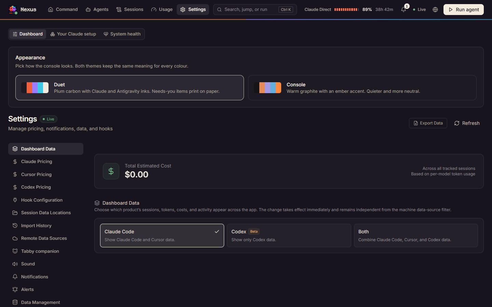

Three sections:

- **Dashboard:** appearance (theme), data source (Claude Code, Codex, or both), model pricing, hooks, session data locations, import history, remote sources, the optional Tabby companion, sounds, notifications, alerts, data, and about. One section at a time, picked from the side menu.
- **Your Claude setup:** skills, subagents, slash commands, memory, plugins, marketplaces, MCP servers, hooks, keybindings, settings, and output styles found on this machine.
- **System health:** database, server, hooks, and cache status.

### Run agent

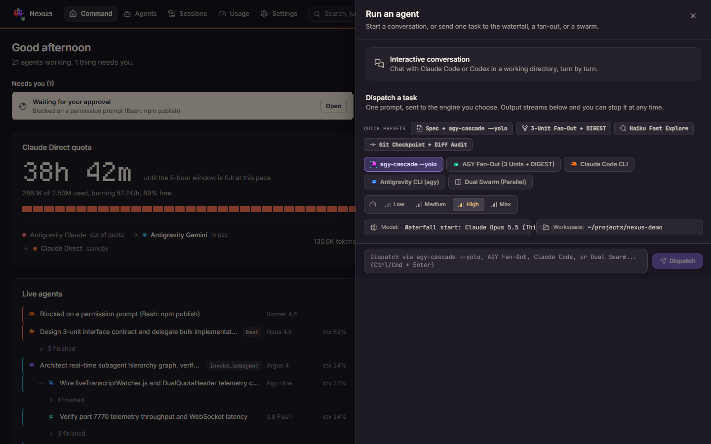

**Run agent** opens the Launch panel with two ways to start work:

- **Interactive conversation** with Claude Code or Codex in a working directory, turn by turn.
- **Dispatch a task:** one prompt sent to `agy-cascade` (the 3-pool waterfall), an AGY fan-out with a digest, Claude Code, Antigravity, or a dual swarm. Presets fill engine, model, effort, and a prompt template; output streams live and you can stop it at any time. Running dispatches keep streaming when you close the panel.

### Search and keyboard

Press `Ctrl K` (`Cmd K` on macOS) anywhere to jump to a section, view, session, Settings section, or Claude config tab, or to run an action (check for updates, toggle sounds, run an agent). Recent commands come first.

---

## How the colours work

Colour always means something, and status never relies on colour alone.

| Meaning | Ink | Where you see it |
| --- | --- | --- |
| **Claude Direct** (Anthropic subscription, pool 3) | Vermilion | Pool dots, the fuel gauge, the thin left edge of agent rows, timeline bars |
| **Antigravity Claude** (Google-paid Opus / Sonnet / GPT-OSS, pool 1) | Violet | Same forms |
| **Antigravity Gemini** (Google-paid Argon / Pro / Flash, pool 2) | Cyan | Same forms |
| **Needs you** | Paper (inverted) | Slips on Command, the bell badge, the Board's first column |
| Working / Waiting / Error / Done | Green / Amber / Coral / Grey | A dot plus the word |

Two themes ship, both with the same meanings: **Duet** (default: plum carbon with the two agent inks, Needs-you items printed on paper, pixel numerals) and **Console** (warm graphite with an ember accent). Switch in **Settings > Dashboard > Appearance**.

---

## The 3-pool waterfall

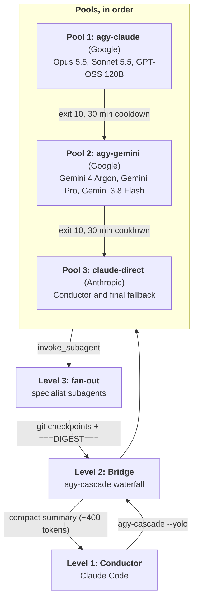

Work pours from pool 1 to pool 3; Claude Direct is the pool to protect. Cooldowns are tracked from `~/.cache/agy-cascade/<pool>.exhausted` and pushed live over WebSocket (`cascade:status`). The [`contrib/agy-cascade`](./contrib/agy-cascade/) kit has the reference script, a ready-to-paste `CLAUDE.md` snippet, and the full manual.

---

## Coming from v3.1?

Every old address still works and redirects:

| Old | New |
| --- | --- |
| `/` Overview | `/` **Command** |
| `/world`, `/rooms`, `/kanban`, `/cascade-graph` | `/agents` (`?mode=world`, `board`, `tree`) |
| `/activity` | `/sessions?show=events` |
| `/quota-roi`, `/analytics`, `/workflows` | `/usage` |
| `/cc-config` | `/settings?section=claude` |

The always-on quota strip is now the fuel gauge and its popover; the floating Command Center dock is now **Run agent**; Tabby is off by default (turn it on in Settings).

---

## More

- **CLI:** `ccam` gives terminal access to everything the dashboard shows (`ccam help`, reference in [`docs/CLI.md`](./docs/CLI.md)).
- **MCP server:** dashboard operations as tools for your agents ([`docs/MCP.md`](./docs/MCP.md)).
- **Extensions:** 14 plugins, 66 plugin skills, 18 Claude subagents, 34 Claude commands, and 77 total repository skills across Claude Code and Codex.

```bash
claude plugin marketplace add juanmarboledao2304/dual-agent-nexus
codex plugin marketplace add juanmarboledao2304/dual-agent-nexus
```

## Attribution and license

- **DualAgent Nexus**, the 3-pool `agy-cascade` waterfall, and the Nexus Console interface: designed and built by **Juan Manuel Arboleda Orozco** ([@juanmarboledao2304](https://github.com/juanmarboledao2304)).
- **Base platform:** adapted under the MIT License from [Claude-Code-Agent-Monitor](https://github.com/hoangsonww/Claude-Code-Agent-Monitor) by **Son Nguyen** ([@hoangsonww](https://github.com/hoangsonww)).
- Pixel display font: [Departure Mono](https://departuremono.com) by Helena Zhang, SIL Open Font License 1.1.
- **License:** [MIT](./LICENSE).
