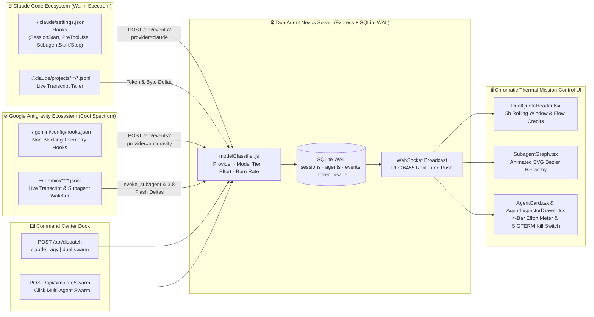

# DualAgent Nexus — Unified Mission Control for Claude Code & Google Antigravity

### Real-time Interactive Mission Control, Subagent Hierarchy Graph, Chromatic Thermal Telemetry & Unified Prompt Dispatcher

Monitor and command **Claude Code** and **Google Antigravity (`agy` CLI / `~/.gemini`)** subscriptions simultaneously — alongside Cursor and OpenAI Codex — in a single local-first, cyber-obsidian command center.

> [!TIP]
> **Complete guides:** [English](./README-EN.md) · [中文](./README-CN.md) · [Tiếng Việt](./README-VN.md) · [한국어](./README-KO.md) · [Español](./README-ES.md)


-Cool_Spectrum-3b82f6?style=flat-square&logo=google&logoColor=white)


---

## Quick Start (1-Command Setup)

**Requirements:** Node.js 22.22+ and npm 9+.

```bash
git clone https://github.com/hoangsonww/Claude-Code-Agent-Monitor.git
cd Claude-Code-Agent-Monitor
npm run setup && npm run dev
```

Open **[http://localhost:5173](http://localhost:5173)** (or run `npm run build && npm start` for production on **[http://localhost:4820](http://localhost:4820)**).

Click **`⚡ Simulate Swarm`** in the top Dual-Subscription Telemetry Header to immediately launch a 25-second realistic multi-agent swarm across **Claude Opus 4.6 + Sonnet 4.6 + 3x Haiku 4.5 `Explore` subagents** and **Google Antigravity Argon 4 + Flow + 3x Gemini 3.8 Flash subagents**.

---

## Dual-Provider Telemetry Architecture



---

## Chromatic Thermal UI System (Warm vs. Cool Encoding)

Every agent node, subagent card, SVG bezier edge, and quota gauge is deterministically color-encoded by **Provider** and **Model Tier / Reasoning Effort** so you can identify which subscription, model, and effort level is burning tokens at a glance:

| Provider Spectrum | Tier / Effort | Thermal Color | Hex / Tailwind | Models & Subagent Roles |
| --- | --- | --- | --- | --- |
| 🔥 **Claude Code (Warm)** | `heavy` (`high` / `max`) | 🔴 **Crimson Red** | `#ef4444` (`red-500`) | `claude-opus-4-6`, Deep Architecture & Root Orchestration |
| 🔥 **Claude Code (Warm)** | `standard` (`medium`) | 🟠 **Vibrant Orange** | `#f97316` (`orange-500`) | `claude-sonnet-4-6`, Primary Coding, `Plan`, `Verifier` |
| 🔥 **Claude Code (Warm)** | `light` (`low`) | 🟡 **Amber Yellow** | `#fbbf24` (`amber-400`) | `claude-haiku-4-5`, High-speed `Explore` / `Task` / `Search` Subagents |
| ❄️ **Google Antigravity (Cool)** | `heavy` (`high` / `max`) | 🟣 **Electric Purple** | `#a855f7` (`purple-500`) | `argon-4-ultra`, `gemini-3-pro`, Deep Reasoning Orchestrator |
| ❄️ **Google Antigravity (Cool)** | `standard` (`medium`) | 🔵 **Cyber Blue** | `#3b82f6` (`blue-500`) | `gemini-3-flow`, Standard `agy` Agentic Coding & Tool Execution |
| ❄️ **Google Antigravity (Cool)** | `light` (`low`) | 🟢 **Emerald Green** | `#10b981` (`emerald-500`) | `gemini-3.8-flash`, High-Speed Parallel Reconnaissance Subagents |

Each card and graph node also features a **4-Bar Effort Signal Meter (`LOW`, `MED`, `HIGH`, `MAX`)** glowing in the card's thermal color, a live context window progress bar, and a **SIGTERM Stop/Kill switch**.

---

## Dispatching Prompts & Connecting Terminal Sessions

### 1. Dispatch Prompts from the Command Center Dock
1. Click the **Command Center Dock** bar at the bottom of the dashboard (or press `Ctrl/⌘ + Enter` inside the prompt input).
2. Choose your **Target Engine**:
   - **Claude Code CLI** (Warm Orange/Red) — spawns `claude -p "<prompt>" --model <model> --output-format stream-json --verbose`
   - **Antigravity CLI (`agy`)** (Cool Purple/Blue) — spawns `agy --prompt "<prompt>" --model <model> --effort <effort>`
   - **Dual Swarm (Parallel Mode)** — dispatches your prompt to **both** subscriptions simultaneously for side-by-side execution.
3. Select a **Model Override** (`claude-opus-4-6`, `claude-sonnet-4-6`, `claude-haiku-4-5`, `argon-4-ultra`, `gemini-3-pro`, `gemini-3-flow`, `gemini-3.8-flash`) and **Reasoning Effort** (`Low ⚡`, `Medium ⚙️`, `High 🧠`, `Max 🔥`).
4. Watch the live `stdout`/`stderr` stream in the dock console or click any spawned node in the **Subagent Hierarchy Graph** to open the **Slide-Over Inspector** and send `SIGTERM` if a subagent enters a loop.

### 2. Connect Existing Terminal Sessions (Non-Destructive Hooks)
Run the hook installer to attach both `~/.claude/settings.json` and `~/.gemini/config/hooks.json` without overwriting any of your existing hooks or settings (a timestamped `.bak` backup is created automatically before any write):

```bash
npm run install-hooks
```

- **Claude Code hooks** (`SessionStart`, `UserPromptSubmit`, `PreToolUse`, `PostToolUse`, `SubagentStart`, `SubagentStop`, `Stop`, `Notification`) stream to `http://127.0.0.1:4820/api/hooks`.
- **Google Antigravity hooks** stream asynchronously to `http://127.0.0.1:4820/api/events?provider=antigravity`.
- **Live Transcript Watcher (`server/watchers/liveTranscriptWatcher.js`)** tails `~/.claude/projects/**/*.jsonl` and `~/.gemini/**/*.jsonl` in real time to compute token deltas, byte throughput, and rolling 5-hour burn rates.

---

## Choose How to Run

| Option | Best for | Guide |
| --- | --- | --- |
| Source checkout | Development and local customization | [Full setup guide](./README-EN.md#quick-start) |
| Desktop app | A persistent macOS or Windows app with tray controls | [Desktop guide](./DESKTOP.md) |
| Docker or Podman | Isolated local or server deployments | [Deployment guide](./DEPLOYMENT.md) |
| Kubernetes or Terraform | Production infrastructure | [Deployment reference](./docs/DEPLOYMENT.md) |
| MCP sidecar | Agent-driven dashboard queries and guarded operations | [MCP guide](./mcp/README.md) |

## Extensions and Automation

CCAM ships **14 plugins**, **66 plugin skills**, **18 Claude subagents**, **34 Claude commands**, and **77 total repository skills** across Claude Code and Codex formats.

```bash
claude plugin marketplace add hoangsonww/Claude-Code-Agent-Monitor
codex plugin marketplace add hoangsonww/Claude-Code-Agent-Monitor
npx skills add hoangsonww/Claude-Code-Agent-Monitor --list
```

## Documentation

- **Complete product and operational reference:** [README-EN.md](./README-EN.md)
- **Documentation index:** [docs/README.md](./docs/README.md)
- **Architecture:** [ARCHITECTURE.md](./ARCHITECTURE.md)
- **CLI:** [docs/CLI.md](./docs/CLI.md)
- **REST and OpenAPI:** [docs/API.md](./docs/API.md)
- **Hooks and lifecycle:** [docs/HOOKS.md](./docs/HOOKS.md)
- **Database:** [docs/DATABASE.md](./docs/DATABASE.md)
- **Plugins:** [docs/PLUGINS.md](./docs/PLUGINS.md)
- **MCP:** [docs/MCP.md](./docs/MCP.md) and [mcp/README.md](./mcp/README.md)

## License

MIT. See [LICENSE](./LICENSE).
