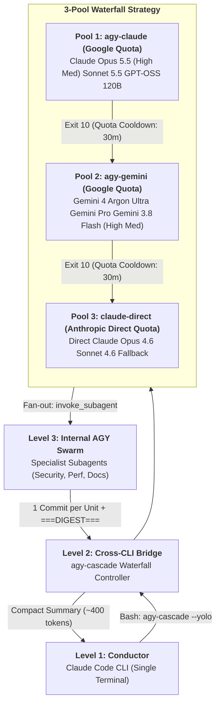

# `contrib/agy-cascade`: 3-Pool Waterfall & Cross-CLI Delegation Kit

Welcome to the **DualAgent Nexus `agy-cascade` Starter Kit**! This toolkit enables the **"Two AIs, One Terminal, Three Quota Pools"** workflow, bridging Anthropic's **Claude Code** and Google's **Antigravity CLI** directly inside the same terminal and mission control dashboard.

---

## The Architecture: Two AIs, One Terminal, Three Quota Pools

DualAgent Nexus treats Claude Code as your **Conductor (Level 1)** and Google Antigravity as your **Heavy Task Worker & Subagent Swarm Engine (Level 2 & Level 3)**. Work is routed through a prioritized 3-pool waterfall that guarantees maximum throughput, lowest cost, and zero context thrashing.



### 1. Pool 1: `agy-claude` (Google Subscription)
- **Models:** Claude Opus 5.5 Thinking (`heavy`, Electric Fuchsia `#d946ef`), Claude Sonnet 5.5 Thinking (`standard`, Neon Indigo `#6366f1`), GPT-OSS 120B Medium.
- **Priority:** First choice for high-reasoning, heavy refactoring, or algorithmic work routed through Google quota.

### 2. Pool 2: `agy-gemini` (Google Subscription)
- **Models:** Gemini 4 Argon Ultra (`heavy`, Amber `#f59e0b`), Gemini Pro, Gemini 3.8 Flash High (`light`, Cyan `#06b6d4`).
- **Priority:** Automatic failover upon Pool 1 quota depletion (Exit Code `10`), or primary choice for rapid iteration and parallel internal subagent fan-out.

### 3. Pool 3: `claude-direct` (Anthropic Subscription)
- **Models:** Claude Opus 4.6, Claude Sonnet 4.6, Claude Haiku 4.5.
- **Priority:** The Conductor's native runtime environment and resilient final fallback when both external pools enter their 30-minute cooldown window.

---

## The `===DIGEST===` Context Discipline

When invoking deep swarms (Level 3), running full transcripts back into the Conductor consumes precious context window tokens and degrades reasoning.

`agy-cascade` enforces the **Digest Protocol**:
1. Specialist subagents complete their assigned work independently.
2. Changes are checkpointed to Git with descriptive commits (`checkpoint: <unit-name>`).
3. Only the structured `===DIGEST===` block is emitted back to the Conductor:

```markdown
===DIGEST===
- Status: SUCCESS
- Files Touched: server/routes/hooks.js, client/src/components/SubagentGraph.tsx
- Key Findings: Verified zero XSS vectors; validated 3-level graph telemetry.
- Follow-Ups: Run git diff verification before release.
```

DualAgent Nexus automatically detects this block, records up to **+45,000 offloaded tokens** saved, and displays the execution summary inside the **Agent Inspector Drawer**.

---

## Quick Setup Guide

### 1. Add the Rule to Your Claude Code Config
Copy [`CLAUDE.snippet.md`](./CLAUDE.snippet.md) into your local project's `CLAUDE.md` or global `~/.claude/CLAUDE.md`.

### 2. Install the Bridge Script
Make `agy-cascade` executable and place it on your system `$PATH`:
```bash
cp contrib/agy-cascade/agy-cascade.example.sh ~/.local/bin/agy-cascade
chmod +x ~/.local/bin/agy-cascade
```

### 3. Wire Hooks to Mission Control
```bash
npm run install-hooks --all
```
Both `~/.claude/settings.json` and `~/.gemini/config/hooks.json` will report events live to `http://127.0.0.1:7770/api/events`.

### 4. Monitor Live Waterfall & Cooldowns
Launch the dashboard:
```bash
npm run dev
```
Open [http://localhost:7770](http://localhost:7770) to view:
- **3-Pool Waterfall Header** with active countdown timers for cooling-down pools.
- **Subagent Topology Graph** showing Conductor Bridge L3 Fan-Out Specialists.
- **Tokens Offloaded Counter** tracking cumulative context savings.
